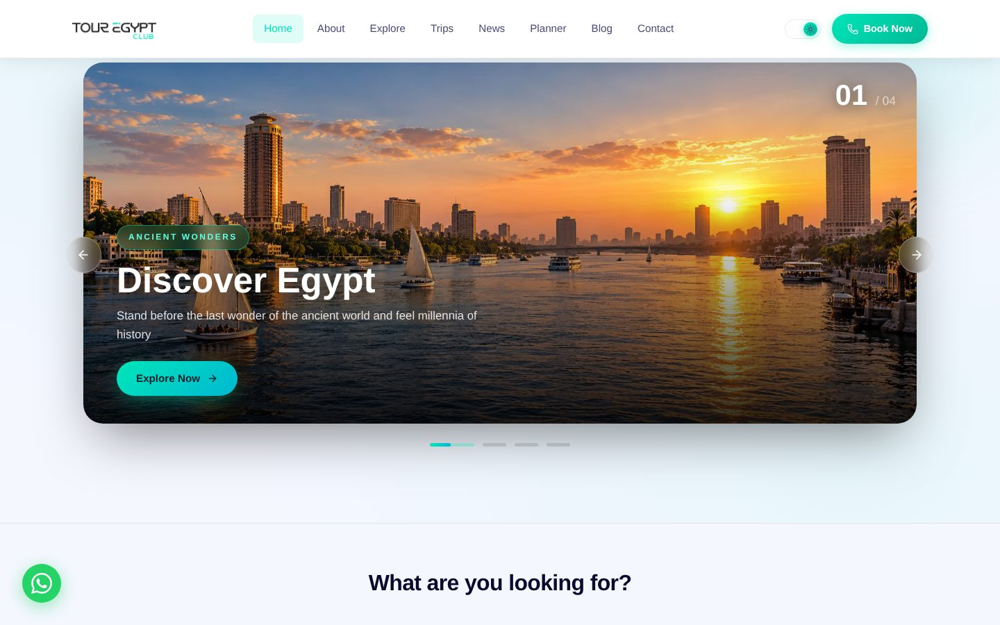
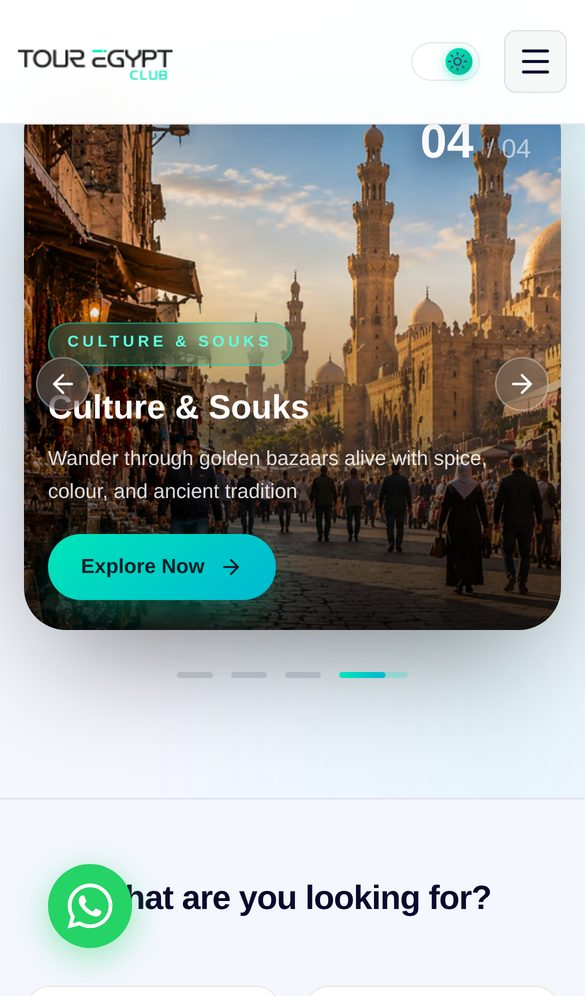

<div align="center">

# Tour Egypt Club

**A bilingual (Arabic / English) front end for an Egyptian tourism company's tours and booking site, built with Next.js 16 and React 19.**

[](https://github.com/Eslamraafat1/Travel/actions/workflows/e2e.yml)


[**Live Site**](https://touregyptclub.com/) · [**Portfolio**](https://new-portfolio-ashy-xi.vercel.app) · [**LinkedIn**](https://www.linkedin.com/in/eslamraafat-dev/)

<br />


&nbsp;


<sub>The production site at touregyptclub.com on desktop (1440×900) and on an iPhone 13.</sub>

</div>

---

## 📌 Overview

Tour Egypt Club is a **client project**: the website of a tourism company. It sells day trips, multi-day packages and Nile and Red Sea holidays across Egypt to local and international travelers.

The front end had to solve three problems:

1. **Two audiences, two scripts.** Arabic and English speakers need the same content, and Arabic needs a correct right-to-left layout.
2. **Discovery before booking.** Travelers browse, filter and compare trips and packages, plan a route and find places nearby before they commit.
3. **Search visibility.** Most international customers arrive from search engines, so the site needs clean metadata and a structure that search engines can crawl.

> **About this repository:** it is the front-end codebase of the project: pages, components, i18n and an API layer with mock data. The production site at [touregyptclub.com](https://touregyptclub.com/) is deployed separately from a later version and has grown beyond this snapshot (for example, Blog, News and Travel Guide sections). This repository is not what serves the live site. Its own SEO layer, tests and CI run against a local production build of **this** code; a small optional smoke test for the live site is kept separately.

## 🗂 Content

The catalogue in this repo **mirrors the client's real catalogue** on [touregyptclub.com](https://touregyptclub.com/) (captured from the live site's public API in November 2026), not template data:

- **5 trips** (VIP tour inside Giza Pyramids, Sharm El-Sheikh Diving Adventure, Western Desert Safari, Pyramids & Cairo Explorer, Luxor & Aswan Nile Cruise) and **2 packages** (Hurghada & Red Sea Luxury, Cairo & Giza Pyramids Package), with titles, EGP prices, durations, itineraries, inclusions/exclusions, FAQs, upgrades and cancellation terms as published.
- **Photos** are the client's own, downloaded from the live site and stored as optimised WebP (max 1600 px wide) in [`public/images/egypt`](./public/images/egypt); partner logos in [`public/images/partners`](./public/images/partners). Live photos that clearly show the wrong place (e.g. a non-Egyptian landscape on an Egypt tour) were not used; a photo from the same tour's own gallery was used instead.
- **Contact details** (phone/WhatsApp, `sales@` e-mail, Giza address, opening hours), the "Why choose us" points, the success partners and the trip-planner categories, featured destinations and scenic routes come from the live site.
- **Not copied on purpose:** star ratings, review counts, testimonials, traveller/years counters and team members. They could not be verified, so the home page counts trips, packages and destinations from the catalogue instead, and no `AggregateRating` is emitted.
- **Arabic:** UI strings are shared with the live site's own Arabic dictionary. The live site publishes tour content in English only, so trip and package text is English in both languages (marked `dir="auto"` so it lays out correctly inside the RTL page).

## ✨ Key Features

### Booking journey
- **Packages and trips:** listing pages filter by type or category, text search, duration and price range. Detail pages show the itinerary, what is included and excluded, highlights and FAQs.
- **3-step checkout** (`/checkout/[id]`): personal info, then booking details, then payment method, with a progress indicator.
- **Trip planner** (`/planner`): matches the "to" destination (English or Arabic name) against the real trips and packages and links to them; also shows the live site's travel styles, featured destinations and scenic routes.
- **Explore guide** (`/explore/[category]/[id]`): nearby restaurants, hotels, cafés, activities, transport and essentials from the **Foursquare Places API v3**. It falls back to built-in mock data when no API key is set.
- **Content dashboard** (`/dashboard`): add, edit and delete trips and packages, and override home-page text for each language. Changes are saved in `localStorage`, so this is a demo admin layer. It sits behind a client-side guard (redirects to `/login?next=/dashboard`) and is `noindex`.
- Login and register screens backed by a **mock** `AuthContext` (any e-mail/password "logs in"; nothing is verified). A real deployment needs server-side auth.
- **Checkout validation:** each step is validated (required fields, e-mail format, phone pattern, no past dates) before the next one opens.

### i18n & RTL
- A custom `LanguageContext` with dot-path translation keys, `{param}` interpolation and a fallback to the key. `src/locales/en.js` and `src/locales/ar.js` each hold about 700 lines of strings.
- Arabic is the default. A **language toggle** in the navbar switches Arabic/English; the choice is saved, the server renders `<html lang="ar" dir="rtl">`, and an inline script in `<head>` applies a saved English preference **before first paint**. Language is a client preference (no `/ar` or `/en` URLs), so there are no hreflang alternates.
- Navbar labels come from the same dictionary; the server HTML contains real Arabic strings (not translation keys).
- Data-level localization (`src/lib/localizeContent.js`) maps `titleEn`, `itineraryEn`, `faqsEn` and similar fields onto trips and packages.
- Two fonts self-hosted with **`next/font`**: **Outfit** for Latin text and **Cairo** for Arabic (no runtime request to Google Fonts).

### UI / UX
- Light and dark themes through `ThemeContext` and a `data-theme` attribute, saved for each visitor.
- Motion with **Framer Motion** (`motion` and `AnimatePresence`) across pages, and **GSAP + ScrollTrigger** on the Explore pages.
- Statistic counters that animate when they scroll into view (`IntersectionObserver` and `requestAnimationFrame` with easing).
- A responsive navbar whose mobile menu closes on route change, a scroll-to-top button and a custom 404 page.
- Component-scoped styles with **CSS Modules**, and icons from `lucide-react`.

### Back-end integration
- One **Axios** client (`src/lib/api/config.js`): base URL from an environment variable, a 10 s timeout, a request interceptor that adds a `Bearer` token and a response interceptor that logs errors globally.
- All endpoints are defined in one file (`src/lib/api/endpoints.js`). One `USE_MOCK_API` flag (currently `true`: there is no back end in this repo) switches every service from mock data to the real REST API.
- A **Route Handler** at `GET /api/places` proxies the Foursquare Places API with a **server-only** `FSQ_KEY`, validates its parameters, and reports `{ configured: false }` when no key is set so the UI falls back to demo data. The key is never shipped to the browser.

## 🛠 Tech Stack

| Area | Tools |
|---|---|
| Framework | Next.js 16.2.10 (App Router), React 19.2.4, React Compiler (`babel-plugin-react-compiler` 1.0.0) |
| Language | JavaScript (ES modules), `@/*` path alias |
| Styling | CSS Modules, CSS custom properties for theming, `next/font` (Outfit, Cairo), `next/image` |
| Animation | Framer Motion 12, GSAP 3.15 (ScrollTrigger) |
| Data / APIs | Axios 1.x, Foursquare Places API v3 (via a Route Handler) |
| Icons | lucide-react |
| Code quality | ESLint 9 with `eslint-config-next` (Core Web Vitals rules) |
| Testing | Playwright 1.63 (Desktop Chrome and Pixel 7 emulation) |
| CI | GitHub Actions: lint, build, E2E against the local build |

## 🔍 SEO & Performance

- **Metadata API** with `metadataBase`, a `%s | Tour Egypt Club` title pattern and per-route `layout.js` metadata: unique title and description, absolute **canonical**, Open Graph and Twitter `summary_large_image` tags. Trip and package pages generate theirs from the catalogue data.
- **Site URL can't leak localhost:** `src/lib/site.js` resolves `NEXT_PUBLIC_SITE_URL` → `VERCEL_PROJECT_PRODUCTION_URL` → `https://touregyptclub.com`, and ignores a localhost value in production builds.
- **`app/sitemap.js`** (static pages, every trip, package and explore category) and **`app/robots.js`** (disallows `/dashboard`, `/checkout/`, `/login`, `/register`, `/api/`; points to the sitemap).
- **JSON-LD:** `TravelAgency` + `WebSite` site-wide; `TouristTrip` (with `Offer`) and `BreadcrumbList` on trip and package pages; `BreadcrumbList` on explore categories. Trip images are absolute URLs and items without a published price get no `Offer`. No ratings/reviews are emitted, because there is no verifiable review source.
- `noindex` on the dashboard, login, register and checkout pages, and on explore place pages while they show demo data.
- Trip, package and explore-category pages are **pre-rendered** (`generateStaticParams`); unknown explore categories return a real **404**.
- **`next/image`** for cards, the home hero and gallery, avatars and the checkout summary (remote hosts are allow-listed; URLs entered in the demo dashboard fall back to unoptimized). **`next/font`** self-hosts the fonts.
- **React Compiler** is on (`reactCompiler: true`).

## 🧪 Testing & QA

The **Playwright** suite in [`e2e/`](./e2e) runs against a **production build of this repository** (Playwright starts `npm run start` itself), with user-flow tests rather than status-code checks:

| Spec | What is verified |
|---|---|
| `catalogue.spec.js` | Trip list (the 5 live trips) → trip detail; case-insensitive search; type filter; price sort is ascending; package category filter → package detail; published price, itinerary (stops vs. days) and upgrades render; no invented ratings; every image is local and loads (no 4xx, no stock-photo hosts); planner search returns the matching catalogue trip |
| `booking.spec.js` | Trip detail → checkout; step-by-step validation (required fields, invalid e-mail, missing date), guest count updates the total, booking confirmation |
| `i18n-theme.spec.js` | Server HTML is `lang="ar" dir="rtl"` with no raw i18n keys; the toggle switches to `lang="en" dir="ltr"` and English nav labels, persists on reload and switches back; theme toggle persists |
| `seo.spec.js` | Titles, absolute https canonical (never localhost), OG/Twitter tags, JSON-LD parses and has `TravelAgency`/`TouristTrip`/`BreadcrumbList`, `robots.txt` → sitemap, `sitemap.xml` URLs, `noindex` on private pages |
| `routing.spec.js` | Custom 404 (status 404), unknown explore category → 404, `/dashboard` → login → back to dashboard, Places proxy falls back to demo data and rejects bad input, key pages render without uncaught errors |
| `navigation.mobile.spec.js` | Mobile menu opens, navigates and closes; language toggle on mobile (Pixel 7) |

- **31 tests** (29 desktop + 2 mobile). CI ([`.github/workflows/e2e.yml`](./.github/workflows/e2e.yml)) runs **lint → build → E2E** on every push to `main` and every pull request; failures keep traces and screenshots, and the HTML report is uploaded.
- `tests/live/smoke.spec.js` is a separate, optional smoke test for the live site (`npm run test:live`, or a manual CI run), since that site is not built from this repo.

```bash
npm run build                 # in the project root
cd e2e
npm install
npx playwright install chromium
npm test                      # starts the build on :3000 and runs the suite
BASE_URL=http://localhost:3000 npm test   # or test a server you started yourself
npm run test:live             # optional: smoke test https://touregyptclub.com
```

## 📁 Project Structure

```text
.
├── .github/workflows/e2e.yml     # Playwright E2E pipeline
├── e2e/                          # Standalone Playwright project (config + tests)
│   ├── tests/local/              # User-flow, i18n, SEO and routing specs (local build)
│   └── tests/live/               # Optional smoke test for the live site
├── docs/screenshots/             # README images
├── public/images/                # Client photos (WebP) and partner logos
└── src/
    ├── app/                      # App Router pages
    │   ├── layout.js             # Root layout: metadata, fonts, JSON-LD, lang/dir script, providers
    │   ├── sitemap.js robots.js  # Generated SEO files
    │   ├── page.js               # Home
    │   ├── packages/ trips/      # Listings + [id] detail pages
    │   ├── explore/              # Places guide: [category]/[id]
    │   ├── planner/              # Trip planner
    │   ├── checkout/[id]/        # 3-step booking flow
    │   ├── dashboard/            # Content/admin demo
    │   ├── about/ contact/ login/ register/
    │   ├── api/places/route.js   # Foursquare proxy (server-only key)
    │   └── not-found.js          # Custom 404
    ├── components/               # Navbar, Footer, TripCard, PackageCard, SmartImage, RequireAuth, ScrollToTop
    ├── context/                  # Language, Theme and Auth providers
    ├── locales/                  # en.js / ar.js translation dictionaries
    └── lib/
        ├── api/                  # Axios client, endpoints, services (packages, trips, explore, planner)
        ├── mockData/             # Trips and packages mirrored from touregyptclub.com
        ├── site.js               # Brand, site URL, metadata helper
        ├── structuredData.js     # JSON-LD builders
        └── localizeContent.js    # Per-language field mapping
```

## 🚀 Getting Started

**Prerequisites:** Node.js 20.9 or newer (Next.js 16 requires it; CI uses Node 20) and npm.

```bash
git clone https://github.com/Eslamraafat1/Travel.git
cd Travel
npm install
npm run dev
```

Then open http://localhost:3000.

### Environment variables (optional)

Copy [`.env.example`](./.env.example) to `.env.local`. The app runs without any of these variables and uses mock data and fallbacks instead.

| Variable | Used in | Purpose |
|---|---|---|
| `NEXT_PUBLIC_SITE_URL` | `src/lib/site.js` | Canonical origin for metadata, sitemap and robots (default `https://touregyptclub.com`) |
| `NEXT_PUBLIC_API_BASE_URL` | `src/lib/api/config.js` | Base URL of the REST back end, used when `USE_MOCK_API = false` |
| `FSQ_KEY` | `src/app/api/places/route.js` | Foursquare Places API key — **server-only**, never sent to the browser |

### Scripts

| Command | Description |
|---|---|
| `npm run dev` | Start the development server |
| `npm run build` | Create a production build |
| `npm run start` | Serve the production build |
| `npm run lint` | Run ESLint |
| `npm run test:e2e` | Run the Playwright suite (after `npm run build`) |

## ☁️ Deployment

The production site at **[touregyptclub.com](https://touregyptclub.com/)** is deployed separately from a later version of the code. This repository builds with `npm run build && npm run start` into a standard Next.js Node server and runs on any Node host; CI tests that local build.

<!-- more-projects:start -->
## More of my work

| Project | What it is | Demo |
|---|---|---|
| **[VANTA](https://github.com/Eslamraafat1/E-commerce-New-)** | 3D bilingual e-commerce storefront | [Live](https://e-commerce-new2-delta.vercel.app/en) |
| **[Atlas Estates](https://github.com/Eslamraafat1/New-Real-Estate)** | 3D real estate platform | [Live](https://new-real-estate-jade.vercel.app) |
| **[Crust & Crave](https://github.com/Eslamraafat1/New-Restaurant)** | cinematic restaurant storefront | [Live](https://new-restaurant-kappa.vercel.app) |
| **[NEXORA Academy](https://github.com/Eslamraafat1/Courses-N)** | bilingual e-learning platform | [Live](https://courses-n.vercel.app) |
| **[Nubia](https://github.com/Eslamraafat1/Perfume)** | perfume store on Supabase | [Live](https://perfume-sooty-alpha.vercel.app) |
| **[MONOLITH](https://github.com/Eslamraafat1/3D-Website-)** | 3D architecture studio site | [Live](https://3-d-website-seven-xi.vercel.app) |
| **[Portfolio](https://github.com/Eslamraafat1/new-portfolio)** | bilingual Next.js portfolio | [Live](https://new-portfolio-ashy-xi.vercel.app) |

See everything on my [GitHub profile](https://github.com/Eslamraafat1) and [portfolio](https://new-portfolio-ashy-xi.vercel.app/).
<!-- more-projects:end -->

## 👤 Author

**Eslam Raafat**, Front-End Developer (React · Next.js · TypeScript)

- Portfolio: [new-portfolio-ashy-xi.vercel.app](https://new-portfolio-ashy-xi.vercel.app)
- LinkedIn: [in/eslamraafat-dev](https://www.linkedin.com/in/eslamraafat-dev/)
- GitHub: [@Eslamraafat1](https://github.com/Eslamraafat1)
- Email: [eslamraafat736@gmail.com](mailto:eslamraafat736@gmail.com)

## 📄 License

This is a client project. All rights reserved. The source code is shared for portfolio review only.
